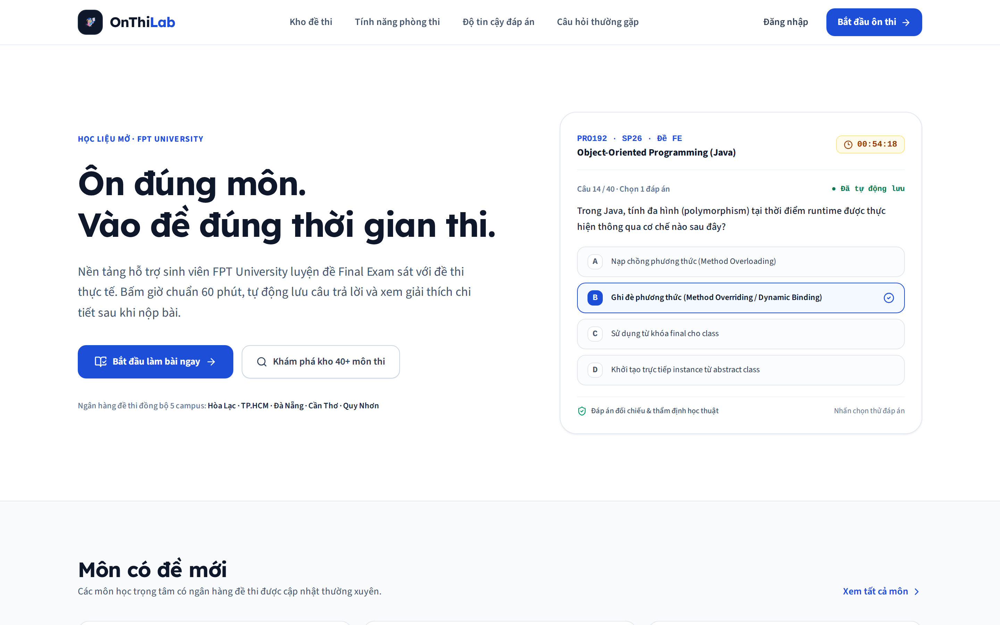
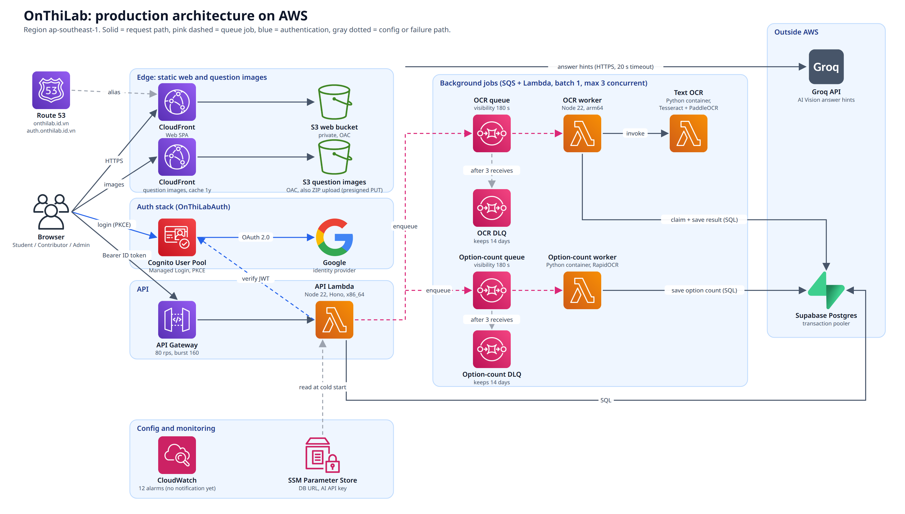

<p align="center">
  
</p>

<h1 align="center">OnThiLab</h1>

<p align="center">
  <strong>Nền tảng luyện thi Final Exam thực tế và chuẩn hóa dành cho sinh viên FPT University.</strong><br />
  <em>A production-grade, serverless exam preparation platform built with React 19, TypeScript, Hono on AWS Lambda, PostgreSQL, and event-driven OCR.</em>
</p>

<p align="center">
  <a href="https://onthilab.id.vn"><strong>🌐 Production App</strong></a> ·
  <a href="https://github.com/tuankiet18-dev/on-thi-lab/actions/workflows/ci.yml"></a> ·
  <a href="#kiến-trúc-hệ-thống-aws"><strong>🏛️ Architecture</strong></a> ·
  <a href="#tác-giả--kết-nối-author"><strong>👤 Author</strong></a>
</p>

<p align="center">
  
  
  
  
  
  
</p>

<p align="center">
  
</p>

---

## 🌐 English Quick Overview

> **OnThiLab** is an educational platform designed to help students at FPT University (across all 5 campuses: Hoa Lac, HCM, Da Nang, Can Tho, Quy Nhon) prepare for 60-minute multiple-choice Final Exams under realistic exam conditions.
>
> **Key Engineering Highlights:**
>
> - **Server-Authoritative Timer & Monotonic Autosave:** Timer expiration (`expiresAt`) is fully owned by the server to prevent client clock manipulation; answers are auto-saved monotonically to prevent race conditions during intermittent connectivity.
> - **Idempotent Submission:** Exam submission is strictly idempotent with immutable exam revisions, guaranteeing zero duplicate evaluations.
> - **Dual-CloudFront CDN:** Completely decouples heavy image bandwidth (thousands of technical diagrams, code screenshots) from API Gateway & Lambda compute through a dedicated CloudFront distribution with Origin Access Control (OAC).
> - **Event-Driven OCR Pipeline:** Asynchronous ZIP imports and image-to-text OCR (Tesseract + PaddleOCR in a Lambda container, English questions only) powered by Amazon SQS with Dead-Letter Queues (DLQ) and an idempotent database claim pattern on ARM64 Graviton Lambdas.
> - **Pragmatic Serverless Cost Optimization:** Eliminates idle VPC/Aurora NAT Gateway costs by leveraging pooled PostgreSQL connections, keeping idle operational cost near $0 while scaling on demand.

---

## 🎯 Vấn đề & Mục tiêu dự án

Tại FPT University, sinh viên phải đối mặt với kỳ thi Final Exam (FE) trắc nghiệm căng thẳng kéo dài 60 phút. Các đề thi lưu hành trước đây gặp nhiều hạn chế:

1. **Thiếu môi trường rèn luyện áp lực thời gian:** Tài liệu trôi nổi dạng file ảnh hoặc PDF rời rạc, không có hệ thống tính giờ và chấm điểm tự động.
2. **Rủi ro mất dữ liệu bài làm:** Khi mạng gián đoạn hoặc sinh viên vô tình tải lại trình duyệt, các hệ thống thông thường dễ mất sạch đáp án đã chọn.
3. **Đặc thù đề thi kỹ thuật:** Nhiều câu hỏi CNTT chứa sơ đồ kiến trúc phần mềm, ERD, mạch điện, biểu đồ phức tạp mà các công cụ OCR thông thường dễ nhận diện sai lệch ký tự.

**OnThiLab** ra đời như một giải pháp toàn diện: mô phỏng chính xác phòng thi thật, tự động lưu tuần tự từng đáp án, bảo vệ tính toàn vẹn của bài thi, và hỗ trợ hiển thị thông minh (**Hybrid OCR**) giữa văn bản chuẩn hóa và ảnh chụp độ nét cao.

---

## ✨ Tính năng nổi bật

### 🎓 Dành cho sinh viên

- **Phòng thi chuẩn học thuật:** Đếm ngược thời gian thực, bảng chuyển câu nhanh (Question Palette), gắn cờ câu hỏi cần xem lại, tự động nộp bài khi hết giờ.
- **Cơ chế lưu bài chống rớt mạng (Monotonic Autosave):** Mọi lựa chọn được gửi lưu tức thì lên máy chủ. Bạn có thể reload trang hoặc mở thiết bị khác để làm tiếp trong thời gian còn lại.
- **Chế độ hiển thị Hybrid OCR & Modal Zoom chi tiết:** Câu hỏi tiếng Anh được hai bộ OCR đọc khớp nhau thì hiển thị dạng text rõ nét; câu nào không chắc (sơ đồ, code, công thức, tiếng Việt) giữ nguyên ảnh đề gốc kèm công cụ phóng to/thu nhỏ và kéo xem chi tiết.
- **Đăng nhập an toàn:** Tích hợp xác thực Google và Email qua Amazon Cognito theo chuẩn **OAuth 2.0 PKCE**.
- **Kho học liệu 5 cơ sở:** Tìm kiếm và lọc đề thi theo mã môn (PRO192, PRF192, CSD201, DBI202, MAS291...), cơ sở và kỳ học. Lưu đề yêu thích và xem biểu đồ phân tích kết quả sau thi.

### 🛡️ Dành cho Quản trị viên & Cộng tác viên

- **Admin Dashboard thời gian thực:** Giám sát trực quan các chỉ số vận hành với bộ lọc 7 / 30 / 90 ngày: đề chờ duyệt, báo lỗi mở, cảnh báo OCR lựa chọn, tỷ lệ hoàn tất bài thi.
- **Nhập đề hàng loạt qua ZIP:** Upload cùng lúc nhiều file ZIP, tự động giải nén và trích xuất câu hỏi.
- **Hệ thống thẩm định đáp án (Review Engine):** Đề xuất đáp án từ `answers.json`, bình luận cộng đồng hoặc AI theo từng câu; bắt buộc người duyệt xác nhận trước khi phát hành.
- **Revision bất biến:** Mỗi lần cập nhật đề tạo ra một bản `exam_revision` độc lập, bảo đảm kết quả thi trong quá khứ không bị thay đổi hồi tố.

---

## 🏛️ Kiến trúc hệ thống AWS

Hệ thống được thiết kế theo mô hình **Pragmatic Serverless Architecture** (Kiến trúc Serverless thực dụng), mô tả hoàn toàn bằng mã nguồn **Infrastructure as Code (AWS CDK TypeScript)**.

<p align="center">
  
</p>

Sơ đồ Mermaid chi tiết từng luồng và cấu hình đã xác nhận nằm ở [docs/aws-architecture.md](docs/aws-architecture.md).

### Phân tích chi tiết các tầng kiến trúc:

| Phân tầng            | Dịch vụ AWS                                                                              | Vai trò kỹ thuật & Điểm đặc biệt                                                                                                                                                                                                                                                                                                                                                                                                                                                                                                                                                                                                                                                                                                                                                                            |
| :------------------- | :--------------------------------------------------------------------------------------- | :---------------------------------------------------------------------------------------------------------------------------------------------------------------------------------------------------------------------------------------------------------------------------------------------------------------------------------------------------------------------------------------------------------------------------------------------------------------------------------------------------------------------------------------------------------------------------------------------------------------------------------------------------------------------------------------------------------------------------------------------------------------------------------------------------------- |
| **Edge & CDN**       | **Amazon Route 53** (ngoài CDK)<br />**Dual CloudFront**<br />**Amazon S3 (OAC)**        | • Tách làm **2 CloudFront Distributions riêng biệt**: 1 phân phối Web SPA (fallback 403/404 -> `/index.html`), 1 phân phối độc lập hàng nghìn ảnh câu hỏi.<br />• Ảnh đề thi được gán hash key bất biến, gắn `Cache-Control: immutable` (cache 1 năm) và phục vụ qua CloudFront riêng, nên **ảnh không đi qua API Gateway/Lambda**. Admin upload ZIP bằng presigned PUT thẳng lên S3.<br />• Khóa 100% truy cập S3 từ internet bằng **Origin Access Control (OAC)** chuẩn mới.                                                                                                                                                                                                                                                                                                                              |
| **Identity & Auth**  | **Amazon Cognito**<br />**Google OAuth 2.0**                                             | • Cognito nằm ở stack riêng (`OnThiLabAuth`), dùng Managed Login hỗ trợ Google IdP và User Pool; production dùng custom domain `auth.onthilab.id.vn`.<br />• API xác thực **Cognito ID token** bằng `aws-jwt-verify`.<br />• Triển khai luồng **Authorization Code Flow with PKCE**, bảo đảm không lưu bất kỳ client secret nào phía trình duyệt.                                                                                                                                                                                                                                                                                                                                                                                                                                                           |
| **Compute & API**    | **Amazon API Gateway**<br />**AWS Lambda (Node 22)**                                     | • API Gateway cấu hình Throttling Guardrails (`RateLimit = 80 req/s`, `BurstLimit = 160 req/s`) giới hạn tải để bảo vệ API và database khi lưu lượng tăng đột biến.<br />• API Handler (Node 22, x86_64, 1024 MB, timeout 29s) đóng gói ESM minified, giới hạn `DATABASE_MAX_CONNECTIONS = 3` trên mỗi container.<br />• Gợi ý đáp án AI Vision (Groq) được gọi **trực tiếp từ API Lambda**, không qua worker hay hàng đợi.                                                                                                                                                                                                                                                                                                                                                                                 |
| **Async Processing** | **Amazon SQS & DLQ**<br />**Worker Lambda (ARM64)**<br />**Text OCR Lambda (container)** | • OCR chạy nền bất đồng bộ qua `OcrQueue` (batch 1, tối đa 3 worker đồng thời, DLQ sau 3 lần). Giải nén ZIP chạy trong API Lambda, không qua worker.<br />• **OptionCountWorker** (Lambda Python container, RapidOCR) đếm số lựa chọn A–F trên ảnh đề qua `OptionCountQueue`, thay cho bước `exam_packager.py` chạy local.<br />• Worker Lambda (ARM64) giữ claim idempotent, lưu kết quả và retry; phần đọc chữ do **Text OCR Lambda** (Python container: Tesseract + PaddleOCR) thực hiện. Chỉ câu **tiếng Anh** mà hai bộ đọc trùng nhau và không có code/công thức/chỗ trống mới thành text; mọi câu khác giữ ảnh gốc.<br />• Áp dụng **Idempotent Claim Pattern**: Worker xác nhận trạng thái trong database trước khi gọi Text OCR Lambda, nên một message bị gửi hai lần vẫn chỉ được xử lý một lần. |
| **Data & Secrets**   | **Supabase PostgreSQL**<br />**AWS SSM Parameter Store**                                 | • Sử dụng **PostgreSQL Transaction Pooler** (Singapore) thay vì dựng Aurora Serverless + VPC NAT Gateway đắt đỏ, giữ chi phí nền ở mức gần $0 khi không có tải.<br />• `DATABASE_URL` và AI API key lưu dạng **SecureString**, Lambda đọc một lần lúc cold start. Google client ID/secret là SSM `String` thường (giới hạn của CloudFormation Cognito).                                                                                                                                                                                                                                                                                                                                                                                                                                                     |
| **Observability**    | **Amazon CloudWatch**                                                                    | • **12 CloudWatch Alarms** giám sát DLQ (`visible >= 1`), tuổi message OCR (>15 phút), lỗi/throttle của Lambda, 5xx và độ trễ p95 (>2s) của API Gateway. Hiện **chưa gắn kênh thông báo** (chưa có SNS).                                                                                                                                                                                                                                                                                                                                                                                                                                                                                                                                                                                                    |

---

## 📐 Quy tắc bất biến hệ thống (System Invariants)

Để đảm bảo tính nhất quán tuyệt đối trong môi trường phân tán, hệ thống áp dụng nghiêm ngặt các quy tắc:

1. **Một attempt duy nhất:** Sinh viên chỉ có tối đa một bài thi ở trạng thái `in_progress` cho mỗi đề tại một thời điểm.
2. **Server sở hữu `expiresAt`:** Thời gian kết thúc bài thi thuộc quyền kiểm soát của máy chủ; đồng hồ đếm ngược trên trình duyệt chỉ đóng vai trò hiển thị.
3. **Monotonic Sequence Autosave:** Mỗi gói tin lưu đáp án mang số thứ tự tăng dần; máy chủ từ chối ghi đè nếu nhận được request trễ hơn do mạng chập chờn.
4. **Idempotent Submission:** Gửi yêu cầu nộp bài là thao tác idempotent — người dùng bấm nộp nhiều lần hoặc mạng chập chờn vẫn trả về đúng một kết quả chấm duy nhất.
5. **Exam Revision Immutability:** Kết quả làm bài luôn gắn chặt với bản revision cụ thể của đề thi; việc chỉnh sửa đáp án sau này không làm thay đổi điểm số lịch sử của sinh viên.
6. **Thẩm định trước khi xuất bản:** Chỉ những đề thi có đầy đủ đáp án đã được kiểm duyệt mới có thể phát hành công khai.

---

## 📂 Cấu trúc Repository (Modular Monolith)

```text
on-thi-lab/
├── apps/
│   ├── web/          # React 19 SPA (TanStack Router, Tailwind CSS, Lucide Icons)
│   ├── api/                # Hono REST API chạy trên AWS Lambda (Node.js 22)
│   ├── worker/             # Worker OCR (ARM64): nhận job từ SQS, gọi Text OCR Lambda, lưu kết quả
│   ├── text-ocr-worker/    # Lambda Python container: Tesseract + PaddleOCR đọc ảnh câu hỏi
│   └── option-count-worker/ # Lambda Python container: đếm số lựa chọn A–F bằng RapidOCR
├── packages/
│   ├── contracts/    # Zod schemas và TypeScript types dùng chung (Single Source of Truth)
│   ├── database/     # Drizzle ORM schema, repositories và migrations
│   ├── importer/     # Logic thẩm định file ZIP, trích xuất ảnh và gợi ý đáp án
│   └── config/       # Shared build & runtime configuration
├── infra/            # AWS CDK TypeScript Stacks (OnThiLabStack, OnThiLabAuthStack)
├── e2e/              # Bộ kiểm thử Playwright End-to-End (Desktop Chromium + Mobile Chromium)
├── load-tests/       # Kịch bản load test (k6)
├── scripts/          # Script deploy và load test
└── docs/             # Tài liệu kiến trúc, runbook vận hành, load testing và capacity planning
    └── images/       # Sơ đồ kiến trúc, ảnh minh họa và script vẽ sơ đồ
```

---

## 📚 Tài liệu

| Tài liệu                                                             | Nội dung                                     |
| :------------------------------------------------------------------- | :------------------------------------------- |
| [docs/architecture.md](docs/architecture.md)                         | Kiến trúc ứng dụng và quy tắc nghiệp vụ      |
| [docs/aws-architecture.md](docs/aws-architecture.md)                 | Hạ tầng AWS production đã đối chiếu với code |
| [docs/code-map.md](docs/code-map.md)                                 | Bản đồ code theo từng domain                 |
| [docs/import-zip-format.md](docs/import-zip-format.md)               | Định dạng file ZIP nhập đề                   |
| [docs/runbook.md](docs/runbook.md)                                   | Vận hành, xử lý sự cố                        |
| [docs/secrets-and-environments.md](docs/secrets-and-environments.md) | Quản lý bí mật và môi trường                 |

---

## 🚀 Bắt đầu phát triển (Quickstart)

### Yêu cầu môi trường

- **Node.js**: v22.0.0 trở lên
- **pnpm**: v10.13.0 trở lên
- **Docker**: (Tùy chọn) Chạy PostgreSQL cục bộ
- **AWS CLI**: (Chỉ cần khi triển khai hạ tầng CDK)

### Cài đặt và khởi chạy

```bash
# 1. Clone repository
git clone https://github.com/tuankiet18-dev/on-thi-lab.git
cd on-thi-lab

# 2. Cài đặt dependencies
pnpm install

# 3. Thiết lập git hooks và file môi trường
pnpm git:setup
cp .env.example .env.local

# 4. Khởi chạy toàn bộ hệ thống (Web :5173 và API :8787)
pnpm dev
```

Truy cập `http://localhost:5173` trên trình duyệt. Khi không có cấu hình Cognito và Database ngoài, ứng dụng tự động chạy ở **Demo Mode** với dữ liệu mẫu hoàn chỉnh để phục vụ phát triển giao diện.

---

## 🧪 Kiểm thử & Chất lượng mã nguồn (Quality Assurance)

Dự án áp dụng tiêu chuẩn kiểm thử tự động nghiêm ngặt trên GitHub Actions CI trước khi merge vào nhánh `main`:

```bash
# Kiểm tra tổng thể trước khi commit / push (Format + Typecheck + Unit Tests + Build)
pnpm validate

# Chạy 13 kịch bản End-to-End, mỗi kịch bản chạy trên Desktop Chromium và Mobile Chromium (26 lượt)
pnpm test:e2e

# Chạy riêng unit & integration tests
pnpm test

# Kiểm tra cú pháp và loại trừ lỗi biên dịch hạ tầng CDK
pnpm infra:synth
```

---

## 🚢 Quy trình Triển khai (Deployment)

Việc triển khai lên AWS được tự động hóa qua script chuẩn lấy trực tiếp output từ CloudFormation:

```bash
# Deploy đầy đủ môi trường Staging
pnpm deploy:staging

# Deploy toàn bộ hạ tầng và ứng dụng Production (bắt buộc cờ xác nhận an toàn)
pnpm deploy:prod --confirm-production

# Chỉ build, upload assets lên S3 và xóa cache CloudFront Production
pnpm deploy:prod:web --confirm-production
```

---

## 👤 Tác giả & Kết nối (Author)

Dự án được thiết kế, phát triển và vận hành bởi:

**Lương Tuấn Kiệt (tuankiet18-dev)**

- 🐙 **GitHub:** [@tuankiet18-dev](https://github.com/tuankiet18-dev)
- 💼 **Dự án:** [OnThiLab — onthilab.id.vn](https://onthilab.id.vn)
- 📬 **Đóng góp & Feedback:** Mọi ý kiến đóng góp, mở Issue hoặc Pull Request đều được hoan nghênh nồng nhiệt!
