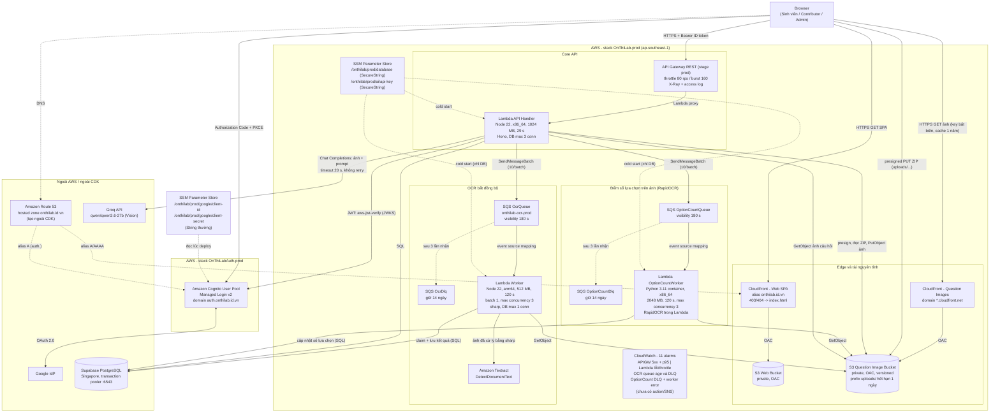

# Kiến trúc hạ tầng AWS

Tài liệu này mô tả hạ tầng **production** (`ap-southeast-1`) và được đối chiếu
với `infra/lib/*.ts`, các CloudFormation template đã synth và tài nguyên đang
chạy (kiểm tra bằng AWS CLI ngày 2026-10-06). Khi có xung đột, code và tài
nguyên đang chạy là nguồn đúng; cập nhật tài liệu này trong cùng pull request
khi đổi hạ tầng.

## Sơ đồ tổng thể

## Thành phần và cấu hình

| Thành phần    | Cấu hình đã xác nhận                                                                                                                                                                                         |
| ------------- | ------------------------------------------------------------------------------------------------------------------------------------------------------------------------------------------------------------ |
| Web SPA       | S3 private + CloudFront OAC; `index.html` không cache, asset cache 1 năm (`scripts/deploy.sh`); không có WAF.                                                                                                |
| Ảnh câu hỏi   | Bucket riêng, versioned, CloudFront riêng (không alias). Ảnh ghi với `Cache-Control: public, max-age=31536000, immutable`. Route ảnh qua API vẫn còn cho local/client cũ.                                    |
| Upload ZIP    | Browser gọi `GET /v1/admin/imports/presign`, PUT thẳng lên S3 (URL hiệu lực 600 giây), rồi gọi `POST /v1/admin/imports` với `archiveKey`. API đọc ZIP, kiểm tra, giải nén và ghi ảnh lên S3.                 |
| Xác thực      | Cognito ở stack riêng `OnThiLabAuth-<stage>`. SPA dùng Authorization Code + PKCE (S256). API xác thực **ID token** (`tokenUse: "id"`, client ID) bằng `aws-jwt-verify`. Role lấy từ server.                  |
| API Gateway   | REST API, stage `prod`, throttle 80/160, tracing X-Ray, access log, binary media cho ảnh.                                                                                                                    |
| API Lambda    | Node.js 22, **x86_64**, 1024 MB, timeout 29 giây, `DATABASE_MAX_CONNECTIONS=3`. Không đặt reserved concurrency.                                                                                              |
| Worker Lambda | Node.js 22, **arm64**, 512 MB, timeout 120 giây, 1 DB connection, bundle `sharp` cho linux/arm64. Quyền: SSM (DB), S3, SQS (nhận/xóa), `textract:DetectDocumentText`.                                        |
| SQS           | `OcrQueue` (standard, visibility 180 giây, `maxReceiveCount` 3 -> `OcrDlq`). `OptionCountQueue` (visibility 180 giây, `maxReceiveCount` 3 -> `OptionCountDlq`).                                              |
| Secrets       | `DATABASE_URL` và AI key: SSM SecureString (`alias/aws/ssm`), đọc khi cold start. Google client ID/secret: SSM **String thường** do giới hạn của CloudFormation Cognito.                                     |
| Database      | Supabase PostgreSQL (Singapore) qua transaction pooler, ngoài AWS, không có VPC/RDS.                                                                                                                         |
| Quan sát      | 11 CloudWatch alarm prod (2 queue OCR + 2 worker OCR + 1 DLQ OptionCount + 1 worker OptionCount + 3 API Lambda + 2 API Gateway) và các log group 30 ngày. **Không alarm nào có action; không có SNS topic.** |

## Luồng xử lý

### 1. Web và ảnh

`Browser -> Route 53 -> CloudFront Web -> S3 Web`. Ảnh câu hỏi đi
`Browser -> CloudFront Images -> S3 Images`, không qua API Gateway/Lambda.

### 2. Đăng nhập

`Browser -> Cognito (auth.onthilab.id.vn) <-> Google`, trả code, SPA đổi token
bằng PKCE. Mọi request API gắn `Authorization: Bearer <ID token>`; API Lambda
kiểm tra chữ ký, issuer, client ID, loại token và expiry.

### 3. Làm bài

`Browser -> API Gateway -> API Lambda -> Supabase`. Server giữ `expiresAt`;
autosave dùng `sequence` tăng dần (ghi chỉ khi sequence mới >= cũ); submit
idempotent; attempt gắn với `exam_revision` bất biến.

### 4. Nhập đề và OCR (Textract)

1. Admin lấy presigned URL, PUT ZIP lên S3 `uploads/<uuid>/questions.zip`.
2. `POST /v1/admin/imports` (`archiveKey`): API đọc ZIP, validate, giải nén,
   ghi ảnh lên S3, tạo draft (câu hỏi `pending`) trong Supabase. Đáp án gợi ý
   ban đầu (nếu có) đến từ `answers.json`/bình luận cộng đồng
   (`compute-answers`), không từ AI Vision.
3. Nếu `extractText` bật: API gửi từng câu thành một message vào `OcrQueue`
   (gom 10 message/batch khi gọi SQS).
4. Worker (batch 1, tối đa 3 đồng thời):
   claim bằng `UPDATE ... WHERE status='pending'` -> dùng lại kết quả theo
   `imageHash` nếu có (trừ khi `force`) -> đọc ảnh S3 -> `sharp` (xoay EXIF,
   upscale tối đa 2600 px, nền trắng, sharpen, JPEG) -> `DetectDocumentText`
   -> `normalizeQuestionText` -> `classifyQuestion` -> lưu `ocr_metadata`.
   Cờ `needs_review`: `low_confidence`, `has_formula`, `low_resolution`,
   `missing_option_labels`, `too_short` (và `invalid_option_count`,
   `answer_out_of_range` khi lưu). Câu có cờ giữ ảnh gốc (hybrid).
5. Lỗi runtime: worker đặt lại `pending` (trước lần nhận cuối) và throw để SQS
   retry; sau 3 lần nhận message vào `OcrDlq`. Nếu worker bị Lambda timeout
   (không chạy được error handler), câu còn `processing`; lần SQS gửi lại sau
   150 giây trở đi sẽ claim lại được (`OCR_STALE_PROCESSING_MS`, nằm giữa timeout
   120 giây của Lambda và visibility 180 giây của queue).

Textract chỉ dùng `LINE.Text` và `Confidence`; toạ độ không được dùng.

### 4b. Đếm số lựa chọn trên ảnh (RapidOCR)

Thay cho bước `exam_packager.py` chạy ở máy local:

1. Sau khi tạo draft, API gửi mỗi câu vào `OptionCountQueue` (gom 10 message/batch).
   Câu đã có metadata số lựa chọn tin cậy trong `answers.json` (độ tin cậy từ 82%)
   được bỏ qua.
2. `OptionCountWorker` (Lambda Python container, `rapidocr-onnxruntime`) tải ảnh
   từ S3, kiểm tra SHA-256, chạy OCR và nhóm các nhãn `A.`/`B)` theo toạ độ x để
   suy ra số lựa chọn, độ tin cậy và độ đầy đủ (cùng thuật toán với
   `exam_packager.py`).
3. Kết quả ghi vào `questions.option_count_check` (`confirmed`, `uncertain`,
   `conflict`, `failed`). Khi OCR chắc chắn (tin cậy từ 82% và đủ nhãn) và câu
   chưa có đáp án được lưu, worker tự cập nhật `options` theo số nhãn và ghi bằng
   chứng (`optionCount`, `optionCountConfidence`, `optionCountSource: "ocr"`)
   vào gợi ý cộng đồng để luật lưu hàng loạt hiện có tin được. OCR không chắc
   chắn chỉ tạo cảnh báo; đáp án đã lưu không bị đổi; đáp án gợi ý vượt số
   lựa chọn OCR thấy thì gợi ý bị đánh dấu cần duyệt.
4. Job cũ hơn job mới (đã thử lại) bị bỏ qua nhờ `queuedAt`. Kết quả gợi ý AI
   (Groq) vẫn chỉ dùng cho câu tranh luận do admin yêu cầu.

### 5. Gợi ý đáp án AI Vision

1. Admin yêu cầu gợi ý cho **một câu** đang duyệt
   (`POST /v1/admin/exams/:examId/questions/:questionId/ai-suggestion`).
2. Trong production, **API Lambda tự gọi** Groq (không có worker/queue AI):
   đọc ảnh từ S3, key AI đọc từ SSM lúc cold start, gửi ảnh + prompt,
   timeout 20 giây và không retry. Request chờ kết quả rồi mới trả `202`.
3. JSON được kiểm tra bằng Zod (`optionCount` 2..6, `questionType`,
   `proposedAnswers`, `confidence`, `rationale`).
4. Lưu vào `questions.ai_metadata` (`status: suggested`, gồm `optionCount` và
   `proposedType`). **Không** ghi `type`, `options` hay `correct_options`; chỉ
   thao tác lưu của người duyệt mới đổi các trường này và tạo đáp án chính thức.
   Yêu cầu `queued/processing` quá 120 giây được coi là bị bỏ dở và có thể gọi
   lại.

## Khác biệt giữa repo và hạ tầng đang chạy

- **Cognito custom domain** (`auth.onthilab.id.vn`) có trong repo nhưng chỉ
  được bật khi truyền `-c cognitoCustomDomainName` và
  `-c cognitoCustomDomainCertificateArn`; `scripts/deploy.sh` luôn truyền cho
  prod. Chạy `cdk deploy`/`cdk diff` thủ công thiếu hai context này sẽ xoá
  custom domain.
- **Log group thừa:** còn log group `OptionCountWorkerLogGroup` từ một worker
  đã gỡ. Log group `/aws/lambda/<function>` của hai Lambda không có retention.
- **Stack dev lệch repo:** queue OCR của `dev` là FIFO, khác code hiện tại
  (standard queue). Không dùng dev làm nguồn tham chiếu.

## Rủi ro đã biết

- Alarm chưa gắn kênh thông báo (xem `project-status.md`).
- AI Vision trong API Lambda bị giới hạn 29 giây của API Gateway/Lambda và 20
  giây của provider; lỗi 429 không được retry ở production.
- Worker có quyền S3 ghi/xóa dù chỉ cần đọc.
